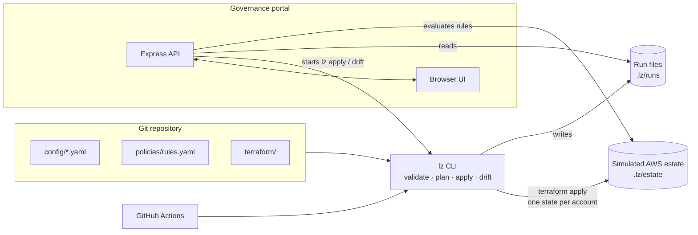

# NorthStar Airlines: Landing Zone Governance PoC

A proof of concept for governing many AWS accounts as code: layered configuration, reusable Terraform modules with one state per account, a ring-based rollout pipeline, and a governance portal that reports deployment, compliance and drift across all accounts.
**AWS is simulated** (as the case study allows): Terraform writes what would be AWS configuration to JSON files. Terraform, the pipeline, GitHub Actions and the portal are real.



## What is real and what is simulated

| PoC | Represents in AWS |
|---|---|
| `organization/<stage>.json` | AWS Organizations OUs and SCPs, one state per stage (exceptions compiled into `aws:PrincipalAccount` conditions) |
| `baseline.json` | CloudTrail to the log archive account, GuardDuty / Security Hub / Inspector delegated to the audit account, S3 / EBS defaults, AWS Backup, Budgets |
| `network.json` | VPC from an IPAM pool, attached to the Transit Gateway owned by the network account |
| `access.json` | IAM Identity Center permission set assignments |
| Terraform workspaces with local state | One S3 state per account and per organization stage |
| `lz-estate` artifact carried between CI runs | Remote backend (S3 + locking) |
| `lz` CLI + GitHub Actions | GitHub Actions with OIDC role chaining (+ AFT for account vending) |
| `policies/rules.yaml` | AWS Config / Security Hub (+ Checkov / OPA in CI) |
| Legacy files overwritten on first apply | Existing resources adopted with Terraform `import` blocks, then reconciled; account enrolled in Control Tower |

## Prerequisites

- Node.js 20.12 or later
- Terraform 1.5 or later (on `PATH`)

## Quick start

```powershell
npm install
npm run tf:init
copy .env.example .env      # enables demo mode
npm run demo:reset          # legacy estate: 2 unmanaged accounts, 4 not deployed
npm start                   # http://127.0.0.1:4000
```

## How configuration works

```
effective settings = merge(global.defaults, environments/<env>.settings, accounts/<name>.overrides)
```

- `config/organization.yaml`: OU tree, SCP statements per OU, core accounts, shared services
- `config/global.yaml`: organization-wide standards (regions, tags, security services, hardening)
- `config/environments/*.yaml`: Dev / Test / Prod settings, network pool, access model
- `config/accounts/*.yaml`: one small file per account (`canary: true` = deployed first in its ring)
- `config/exceptions.yaml`: time-bound governance exceptions (expire automatically)

**Add an account:** create `config/accounts/<name>.yaml` (see `demo/ns-cargo-dev.yaml`) and run the pipeline. It is placed in its environment's OU and receives the baseline.

**Make an organization-wide change:** edit one line in `config/global.yaml` (for example `inspector: true`) and run the pipeline. Every account is updated, ring by ring.

Both go through the same path: pull request → checks and plan → review and merge → rollout in rings.

## The three situations from the case study

| Situation | Today | In this PoC |
|---|---|---|
| **A.** A team needs a new account | Built by hand, differently each time | Copy `demo/ns-cargo-dev.yaml` into `config/accounts/` and run the pipeline: placed in the Dev OU, baseline applied, compliant |
| **B.** Security mandates a new control everywhere | Hundreds of manual changes, no proof | `inspector: true` in `config/global.yaml`: every account updated ring by ring, the Inspector rule passes everywhere |
| **C.** Someone changes a Production network by hand | Unnoticed until an audit | Simulate manual change → Detect drift (exit 2, pinpoints the network component) → Re-apply restores Git |

The two hand-built legacy accounts (`ns-booking-test`, `ns-booking-prod`) become compliant on the first rollout.

## How a rollout works

| Ring | Organization stage(s) applied first | Then |
|---|---|---|
| Dev | `organization/dev`: Dev OU SCP, placement of Dev accounts | Dev accounts |
| Test | `organization/test` | Test accounts |
| Prod (approval) | `organization/core`: Root and shared OU SCPs (they affect every account), then `organization/prod` | Prod canary, then the other Prod accounts |

- SCP changes for an environment OU follow that environment's ring. Root-level changes hit every account at once, so they wait for the Prod approval.
- Canary accounts go first; if one fails, the rest of the ring is skipped.
- Max `LZ_MAX_PARALLEL` (default 3) accounts in parallel, one retry per account. A wave stops starting new accounts once more than 10% of it has failed. A failed ring halts later rings.
- Without approval the run ends as `PARTIAL`: Dev and Test are deployed, Root/core and Prod are not. The portal asks for a named approver, recorded in the run (`approvedBy`), exactly like `--approve-prod --approved-by` on the command line and the `production` environment in CI.

## Commands

| Command | Purpose |
|---|---|
| `npm run lz -- validate` | Schema and cross-checks for all configuration |
| `npm run lz -- plan [--account <name>]` | Terraform plan for the organization stages and each account |
| `npm run lz -- apply [--ring dev\|test\|prod] [--account <name>] [--approve-prod [--approved-by <name>]]` | Rollout as described above. Exit code 0 for `SUCCEEDED` and `PARTIAL`. |
| `npm run lz -- drift` | `terraform plan -detailed-exitcode` per organization stage and account: exit 2 = drifted. An expired exception shows up as drift of its organization stage. |
| `npm run lz -- evaluate [--markdown]` | Compliance per account against `policies/rules.yaml` |
| `npm run lz -- seed --synthetic <n>` | Scale demo: reset, then generate `<n>` (max 600) accounts in `.lz/synthetic/` (never in `config/`), 10% of them legacy |
| `npm run demo:reset` | Reset the estate (incl. synthetic accounts) and undo the demo's config edits |
| `npx tsx demo/dry-run.ts` | Rehearsal: runs and checks the full demo sequence against a running portal |
| `npm test` / `npm run typecheck` | Unit tests (24, vitest) / type check |

## CI/CD

`.github/workflows/pipeline.yml` (shared setup in `.github/actions/setup`):

- **Pull request:** `checks` (type check, unit tests, `terraform fmt` and `validate`, `lz validate`, `lz plan` against the latest estate).
- **Merge to `main`:** `deploy-dev` → `deploy-test` → `deploy-prod`. Prod (including Root/core SCPs) runs in the protected `production` environment and needs manual approval. The compliance summary is written to the job summary.
- **Nightly (03:00 UTC) or manual `task: drift`:** `drift` checks every organization stage and account. If anything drifted (manual change, or an exception that expired), `reconcile` re-applies Git after the same `production` approval.
- The estate is carried between runs as the `lz-estate` artifact (stand-in for an S3 backend), uploaded even when a rollout fails.

**Repository settings the approval depends on:** the `production` environment must have a required reviewer, and `main` should require the `checks` job. GitHub only enforces both on public repositories, or on private repositories with GitHub Pro / Team. On a private Free repository the Prod and reconcile jobs run without waiting for approval.

## Portal

`http://127.0.0.1:4000` (bound to localhost only):

- **Overview:** compliance, drift, exceptions expiring within 30 days or expired, last run
- **Accounts:** per-account rule results, effective settings with their source layer, network, access, SCPs, Re-apply (Prod asks for approval)
- **Pipeline:** live ring view with organization stages and canaries (compact counts for large rings), run history, Detect drift, Simulate manual change (demo mode only)
- **Governance:** Dev / Test / Prod comparison, OU tree with SCPs, shared services, exceptions, rule catalogue

Deep links: `#overview`, `#accounts`, `#pipeline`, `#governance`, and `#accounts/<name>` opens one account's detail (for example `#accounts/ns-booking-prod`).

## Scale demo

```powershell
npm run lz -- seed --synthetic 200   # 206 accounts; 22 legacy
$env:LZ_MAX_PARALLEL = '8'
npm run lz -- apply --approve-prod --approved-by you
npm run lz -- drift
npm start                            # portal shows 206 accounts
npm run demo:reset                   # back to the 6-account demo
```

Measured on a laptop: 206 accounts rolled out in about 215 s with 8 in parallel, drift check of 210 targets in about 169 s, portal summary in under 1 s.

## Project layout

```
config/              organization, global, environment, account and exception files (the source of truth)
policies/rules.yaml  compliance rules evaluated per account
terraform/
  organization/      OU tree and SCPs, one state per stage (core, dev, test, prod)
  account/           per-account root: one state per account
  modules/           account-baseline, network, access, scp
src/                 lz CLI (cli, config, pipeline, terraform, rules, runs, estate) and portal API (server)
public/              portal UI
test/                unit tests (pipeline, rules)
demo/                demo account file and the dry-run rehearsal script
.github/             pipeline workflow and shared setup action
```

The full target design (Control Tower, AFT, OIDC, Prod waves, serverless portal) is in the presentation.
