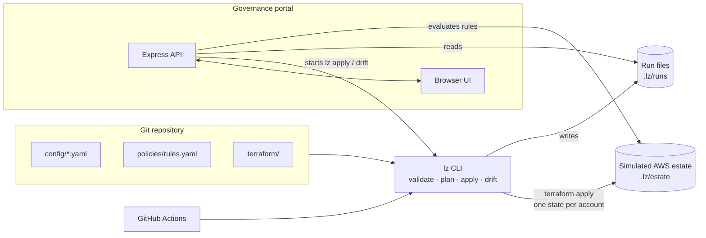

# NorthStar Airlines: Landing Zone Governance PoC

A proof of concept for governing many AWS accounts as code: layered configuration, reusable Terraform modules with one state per account, a ring-based rollout pipeline, and a governance portal that reports deployment, compliance and drift across all accounts.
**AWS is simulated** (as the case study allows): Terraform writes what would be AWS configuration to JSON files. Terraform, the pipeline, GitHub Actions and the portal are real.



## What is real and what is simulated

| PoC | Represents in AWS |
|---|---|
| `organization.json` | AWS Organizations OUs and SCPs (exceptions compiled into `aws:PrincipalAccount` conditions) |
| `baseline.json` | CloudTrail, GuardDuty, Inspector, S3 / EBS defaults, AWS Backup, Budgets |
| `network.json` | VPC from an IPAM pool, Transit Gateway route table |
| `access.json` | IAM Identity Center permission set assignments |
| Terraform workspaces with local state | One S3 state per account |
| `lz` CLI + GitHub Actions | GitHub Actions with OIDC role chaining (+ AFT for account vending) |
| `policies/rules.yaml` | AWS Config / Security Hub (+ Checkov / OPA in CI) |
| Legacy files overwritten on first apply | Existing resources adopted with Terraform `import` blocks, then reconciled; account enrolled in Control Tower |

## Prerequisites

- Node.js 20.12 or later
- Terraform 1.5 or later (on `PATH`)

## Quick start

```powershell
npm install
npm run tf:init
copy .env.example .env      # enables demo mode
npm run demo:reset          # legacy estate: 2 unmanaged accounts, 4 not deployed
npm start                   # http://127.0.0.1:4000
```

## How configuration works

```
effective settings = merge(global.defaults, environments/<env>.settings, accounts/<name>.overrides)
```

- `config/organization.yaml`: OU tree, SCP statements per OU, core accounts
- `config/global.yaml`: organization-wide standards (regions, tags, security services, hardening)
- `config/environments/*.yaml`: Dev / Test / Prod settings, network pool, access model
- `config/accounts/*.yaml`: one small file per account
- `config/exceptions.yaml`: time-bound governance exceptions (expire automatically)

**Add an account:** create `config/accounts/<name>.yaml` (see `demo/ns-cargo-dev.yaml`) and run the pipeline. It is placed in its environment's OU and receives the baseline.

**Make an organization-wide change:** edit one line in `config/global.yaml` (for example `inspector: true`) and run the pipeline. Every account is updated, ring by ring.

## Commands

| Command | Purpose |
|---|---|
| `npm run lz -- validate` | Schema and cross-checks for all configuration |
| `npm run lz -- plan [--account <name>]` | Terraform plan for the organization and each account |
| `npm run lz -- apply [--ring dev\|test\|prod] [--account <name>] [--approve-prod]` | Rollout: organization, then Dev → Test → Prod. Max 3 accounts in parallel, one retry per account, a failed ring halts later rings, Prod only with approval. |
| `npm run lz -- drift` | `terraform plan -detailed-exitcode` per account: exit 2 = drifted |
| `npm run lz -- evaluate [--markdown]` | Compliance per account against `policies/rules.yaml` |
| `npm run demo:reset` | Reset the estate and undo the demo's config edits |
| `npm test` / `npm run typecheck` | Unit tests / type check |

## CI/CD

`.github/workflows/pipeline.yml`:

- **Pull request:** `checks` (type check, unit tests, `terraform fmt` and `validate`, `lz validate`, `lz plan`).
- **Merge to `main`:** `deploy-dev` → `deploy-test` → `deploy-prod`. Prod runs in the protected `production` environment and needs manual approval. The compliance summary is written to the job summary.

## Portal

`http://127.0.0.1:4000` (bound to localhost only):

- **Overview:** compliance, drift, exceptions, last run
- **Accounts:** per-account rule results, effective settings with their source layer, network, access, SCPs, Re-apply
- **Pipeline:** live ring view, run history, Detect drift, Simulate manual change (demo mode only)
- **Governance:** Dev / Test / Prod comparison, OU tree with SCPs, exceptions, rule catalogue

The full target design (Control Tower, AFT, OIDC, Prod waves, serverless portal) is in the presentation.
